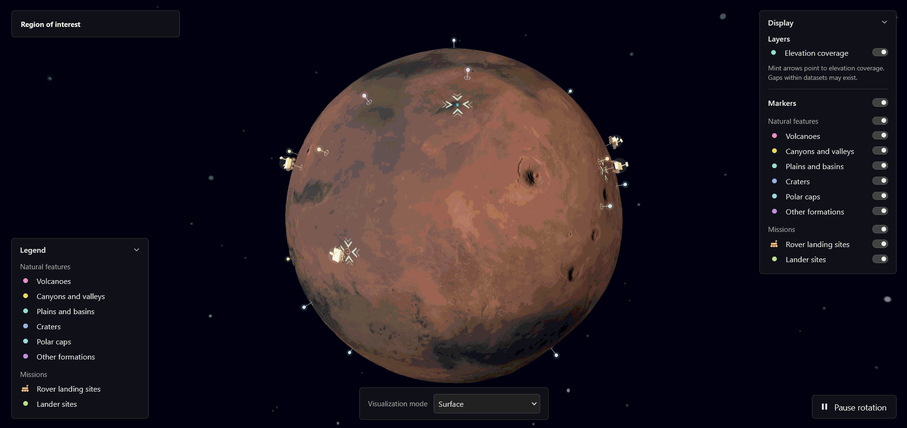
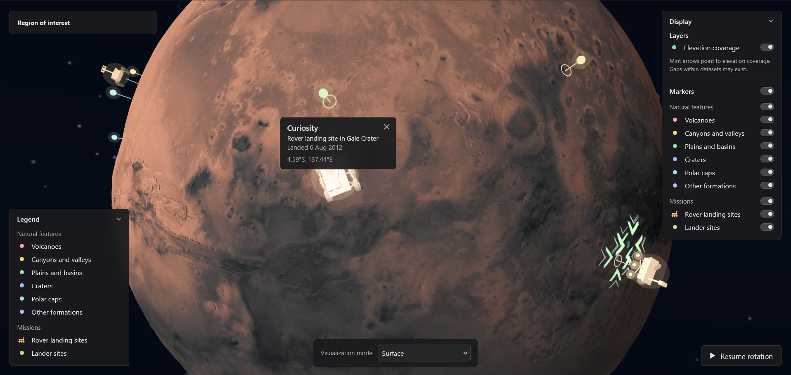
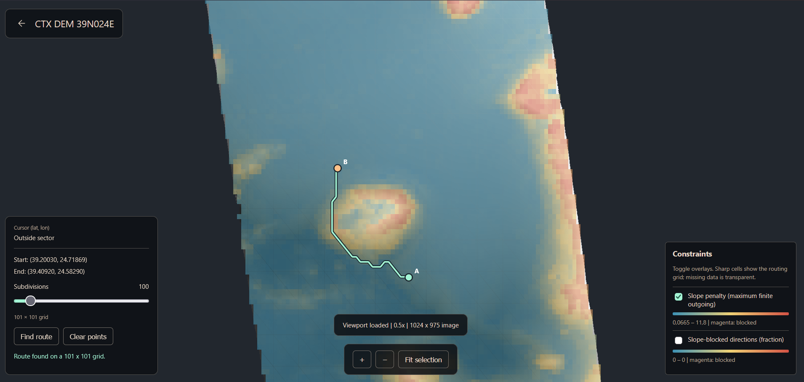

  

  <b>Route planning on the Martian surface for rovers and astronauts.</b>

  

MARS Explorer is an interactive tool to browse Mars in 3D, select an area of
interest, and compute the lowest-cost path across it. The cost depends on who
is travelling: a rover or a human.

*Developed for the NASA Space Apps Challenge 2026.*

---

## Features

- **3D globe of Mars** with pins on points of interest (volcanoes, mountains, previous landing sites).
- **Region selection:** draw a rectangle on the globe to open a detailed view.
- **Profile-based routing:** separate cost models for rovers and humans.
- **Direction-aware costs:** climbing from A to B is not the same as descending from B to A.
- **Perseverance imagery:** real rover photos of the selected area, when available.

---

## User interface

### 3D Mars view
Rotate and zoom the planet. Pins mark notable locations, such as the Curiosity
rover's position.

   
  <em>Pin marking the Curiosity rover.</em>

**Right-click and drag** to select an area and open a high-detail image of it.

### Route planner
1. In the detailed view, zoom in on the area you need.
2. **Right-click twice**: first the **source**, then the **destination**.
3. The lowest-cost path for the chosen profile is drawn on the map.

   
  <em>Lowest-cost path computed between a source and a destination.</em>

---

## How it works

### Cost map
Each terrain cell gets a cost from the **explorer profile** (rover or human).
Costs are stored as a matrix of floats: **the higher the value, the more the
cell is discouraged**.

> Factors used: *[e.g. slope, roughness, elevation, albedo, thermal inertia]*

## NASA data
We used [Mars Trek](https://trek.nasa.gov/mars/#v=0.1&x=0&y=0&z=1&p=urn%3Aogc%3Adef%3Acrs%3AEPSG%3A%3A104905&d=&locale=&b=mars&e=-269.999994963537%2C-128.49609135308955%2C269.999994963537%2C128.49609135308955&sfz=&w=)
 to compare global layers (elevation, dust, exploration-zones perimeters, ...) to choose the exploration zone and to understand what 
each dataset can and cannot tell us at the scale of a walk. We used albedo and thermal inertia maps for visualization on User Interface.
Moreover, we used the data contained on these maps to compute the costs of each path by computing the cost maps.

We used [USGS-NASA Planetary Geologic Mapping program](https://astrogeology-usgs.hub.arcgis.com/pages/interactive-maps-mars)
    to broaden our knowledge on Mars in order to pick interesting targets for the traverses.

We used [Curiosity’s Proposed Path up Mount Sharp](https://science.nasa.gov/resource/curiositys-proposed-path-up-mount-sharp/)
to check that our routes look realistic (they avoid dangerous areas).

We used [Perseverance images](https://mars.nasa.gov/mars2020/multimedia/raw-images/) to help astronauts in recognising their 
while exploring Mars. On a selected area it shows the images taken by the _Perseverance_ rover.

## Other sources
- [NASA Science – Perseverance Rover Components](https://science.nasa.gov/mission/mars-2020-perseverance/rover-components/)
- [Rankin A. et al. (2023). Perseverance Rapid Traverse Campaign. IEEE Aerospace Conference](https://ieeexplore.ieee.org/document/10115835/)
- [NASA/JPL – Looking Back at ‘Purgatory Dune’ (PIA07999)](https://science.nasa.gov/photojournal/looking-back-at-purgatory-dune)
- Morgan P. et al. (2018). A pre-landing assessment of regolith properties at the InSight landing site. Space Sci. Rev. 214:104. doi:10.1007/s11214-018-0537-y
- Golombek M., Rapp D. (1997). Size-frequency distributions of rocks on Mars and Earth analog sites. JGR 102(E2):4117–4129. Golombek M. et al. (2021). Rock size-frequency distributions at the InSight landing site. Earth Space Sci. 8:e2021EA001959
- [Arvidson R.E. et al. (2010). Spirit Mars Rover Mission: overview and selected results from the northern Home Plate Winter Haven to the side of Scamander crater. JGR 115. doi:10.1029/2010JE003633](https://www.planetary.org/articles/2204)
- [NASA SP-4214, Where No Man Has Gone Before, ch. 13](https://www.nasa.gov/wp-content/uploads/static/history/SP-4214/ch13-3.html)
- [Jones C.S., Nola F.J. (1971) NASA TM X-64623](https://ntrs.nasa.gov/api/citations/19720004516/downloads/19720004516.pdf)
- [Jacob S.R. et al. (2026). Apollo LRV as-traversed performance metrics. LPSC](https://ntrs.nasa.gov/citations/20250011301)
- [MIT 16.89 Space Systems Engineering (2007), presentation 06](https://ocw.mit.edu/courses/16-89j-space-systems-engineering-spring-2007/68578981bacd42a67b431cad987a6853_presentation_06.pdf)
- [NASA – Space Exploration Vehicle fact sheet](https://www.nasa.gov/wp-content/uploads/2015/08/464826main_sev_factsheet_508.pdf)
- [NASA EVA-EXP-0075, Exploration EVA System ConOps Summary for Artemis Phase 1](https://www.nasa.gov/wp-content/uploads/2020/01/topic_1-_eva_lunar_surface_concept_of_operations.pdf)
- [NASA ICES-2025-294, Step height evaluation (xEMU)](https://ntrs.nasa.gov/api/citations/20250004496/downloads/ICES2025-294-stepheight-final.pdf)
- [NASA ICES 2026, Mars suit mass presentation](https://ntrs.nasa.gov/api/citations/20260005410/downloads/Mars_Mass_ICES2026_Presentation_Final.pdf)
- [NASA ICES 2026, Mars PLSS plan](https://ntrs.nasa.gov/api/citations/20260003024/downloads/Final_ICES2026_Mars_PLSS_Plan.pdf)
- Pandolf K.B., Givoni B., Goldman R.F. (1977). Predicting energy expenditure with loads while standing or walking very slowly. J. Appl. Physiol. 43(4):577–581
- Santee W.R., Allison W.F., Blanchard L.A., Small M.G. (2001). A proposed model for load carriage on sloped terrain. Aviat. Space Environ. Med. 72(6):562–566
- Looney D.P. et al. (2018). Metabolic costs of military load carriage over complex terrain. Mil. Med. 183(9-10):e357
- Richmond P.W., Potter A.W., Santee W.R. (2015). Terrain factors for predicting walking and load carriage energy costs: review and refinement. J. Sport Hum. Perf. 3(3):1–26
- [Kim K.J. et al. (2024). Metabolic workload estimation for EVA traverse. IEEE EMBC](https://ntrs.nasa.gov/api/citations/20240001423/downloads/IEEE%20EMBC%202024.pdf)
- [Parker L. et al. NESC space-weather operational response time (poster)](https://ntrs.nasa.gov/api/citations/20210014156/downloads/Parker%20el%20al.%20Helio%202050%20workshop%20poster_final.pdf)
- Löwe J.L. et al. (2025). Nowcasting solar energetic particle events for Mars missions. arXiv:2502.02469
- [NASA OCHMO-TB-020, Design for Ionizing Radiation Protection (NASA-STD-3001)](https://www.nasa.gov/wp-content/uploads/2023/03/radiation-protection-technical-brief-ochmo.pdf)
- [NASA OCHMO-TB-009, Physiological Effects of Touch Temperature](https://nasa.gov/wp-content/uploads/2023/03/touch-temperature-technical-brief-ochmo.pdf)
- [Mars Climate Database v6.2, LMD/ESA/CNES](https://www-mars.lmd.jussieu.fr/)
- USGS SIM 3464, Geologic map of Jezero crater and the Nili Planum region, Mars (1:75,000).
- Horn B.K.P. (1981). Hill shading and the reflectance map. Proc. IEEE 69(1):14–47 · Riley S.J. et al. (1999). A terrain ruggedness index. Intermountain J. Sci. 5:23–27

---
>Project developed by: Dalil Osée Ouattara - Matteo Piacentini - Michele Ramalli - Tommaso Viganò - Lorenzo Zani 